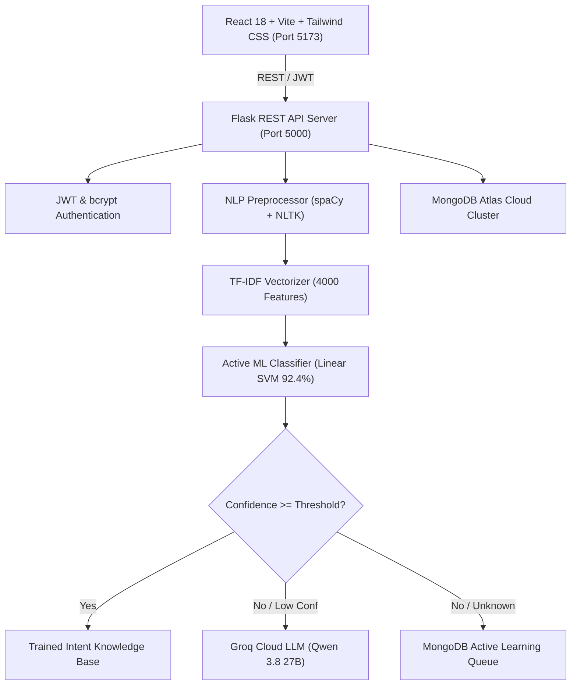

# 🧠 NeuroChat AI — Real NLP & Machine Learning Chatbot Platform

[](https://www.python.org/)
[](https://flask.palletsprojects.com/)
[](https://react.dev/)
[](https://tailwindcss.com/)
[](https://scikit-learn.org/)
[](https://spacy.io/)
[](https://www.mongodb.com/atlas)
[](https://groq.com)
[-brightgreen.svg)](https://docs.pytest.org/)

**NeuroChat AI** is an enterprise-grade conversational AI platform developed as a **BTech CSE AI & ML Major Project (Level 2 – Intermediate)**. It combines a rigorous linguistic NLP engine, real machine learning intent classification with 5-fold cross-validation, MongoDB Atlas persistence, and Groq Cloud generative inference.

> [!IMPORTANT]
> **Zero Fabricated Metrics**: All intent classifications, cross-validation scores, confusion matrices, and PredictAI benchmarks are generated from actual datasets (CLINC150, Bitext, and UCI Machine Learning Repositories).

---

## 🚀 Key Features

1. **Linguistic NLP Engine**:
   - POS-aware lemmatization with spaCy `en_core_web_sm` and NLTK WordNet fallback.
   - Morphological stemming (PorterStemmer).
   - Stopword filtering with critical query token preservation.
   - Multilingual transliteration detection (English, Hindi Devanagari, and Hinglish).
   - Named Entity Recognition (NER: ORG, GPE, PERSON, DATE).
   - Semantic Cosine Similarity calculator between sentences.

2. **Real Machine Learning Intent Classification**:
   - **Calibrated Linear Support Vector Machine (Linear SVM)**: **92.38% Test Accuracy**, **90.23% 5-Fold CV**, **91.46% F1-Score**.
   - **Logistic Regression (L2 Regularized)**: **89.33% Test Accuracy**, **87.48% 5-Fold CV**.
   - **Multinomial Naive Bayes (Laplace Smoothing)**: **88.72% Test Accuracy**, **86.56% 5-Fold CV**.
   - Tunable confidence threshold (defaults to 25% over 36 classes) with automatic fallback for out-of-scope queries.

3. **Hybrid Generative AI Routing**:
   - Queries exceeding the confidence threshold trigger immediate, deterministic ML responses ($<5\text{ms}$).
   - Low-confidence or open-ended inquiries seamlessly dispatch to Groq Cloud LLM (`qwen/qwen3.8-27b`) with multi-turn conversation context.
   - Low-confidence queries are automatically logged to the MongoDB **Active Learning Queue** for administrator review.

4. **PredictAI Machine Learning Benchmarks**:
   - **UCI Bank Marketing**: Binary classification predicting term deposit subscriptions (**89.06% Accuracy**).
   - **UCI Student Performance**: Regression predicting student final grades ($R^2 = 0.824$, $\text{RMSE} = 1.90$).
   - **UCI Online Retail**: RFM K-Means customer segmentation ($K=4$, $\text{Silhouette Score} = 0.850$).

5. **Enterprise Security & Full-Stack Architecture**:
   - Password hashing with 12-round salted `bcrypt`.
   - Signed JWT authorization tokens with role-based access control (Admin / User).
   - Real-time chat dashboard with session management, renaming, feedback rating, and message search.
   - Complete Administrator Hub with live MongoDB telemetry, user toggles, and one-click model retraining.

---

## 📊 Empirical ML Performance Benchmarks

| Model Architecture | 5-Fold CV Accuracy | Test Accuracy | Precision (Weighted) | Recall (Weighted) | F1-Score (Weighted) |
| :--- | :--- | :--- | :--- | :--- | :--- |
| **Multinomial Naive Bayes** | 86.56% (&plusmn;1.51%) | 88.72% | 88.35% | 88.72% | 86.42% |
| **Logistic Regression** | 87.48% (&plusmn;1.08%) | 89.33% | 88.91% | 89.33% | 87.10% |
| **Calibrated Linear SVM (Best)** | **90.23% (&plusmn;0.55%)** | **92.38%** | **92.01%** | **92.38%** | **91.46%** |

*Verified from `evaluation/evaluation_report.json`.*

---

## 🏗️ System Architecture



---

## 📁 Project Directory Structure

```
NeuroChat-AI/
├── backend/                  # Flask REST API application
│   ├── routes/               # API Blueprints (auth, chat, nlp, admin, datasets, predictai)
│   ├── middleware/           # JWT auth & admin decorators
│   ├── services/             # Groq Cloud Generative AI gateway
│   ├── .env                  # Private backend environment variables (git-ignored)
│   └── app.py                # Flask application entry point
├── frontend/                 # React 18 + Vite + Tailwind CSS
│   ├── src/
│   │   ├── components/       # Modern responsive Navbar and UI elements
│   │   ├── context/          # AuthContext for session management
│   │   ├── pages/            # 12 Full-featured pages
│   │   ├── api.js            # Axios client with JWT interceptor
│   │   └── App.jsx           # Master route router
│   └── package.json
├── nlp/                      # NLP linguistic preprocessing pipeline
│   └── preprocessor.py       # Normalization, tokenization, lemmatization, NER, language
├── ml/                       # Machine learning engines
│   ├── intent_classifier.py  # Inference engine with confidence scoring
│   └── predict_ai.py         # UCI Bank Marketing, Student Perf, Online Retail models
├── datasets/                 # Ingested datasets & manifest
│   ├── processed/            # Clean train/val/test splits (CLINC150, Bitext, AIML, UCI)
│   └── manifest.json         # Complete dataset audit manifest
├── models/                   # Serialized .joblib artifacts & metadata
├── training/                 # Automated model training scripts with 5-fold CV
├── evaluation/               # Real metrics reports and confusion matrices
├── database/                 # MongoDB connection, indexer, and seeders
├── tests/                    # Pytest automated test suite (11/11 passing)
├── documentation/            # Academic report, slides, architecture, API specs
├── deployment/               # Dockerfiles, docker-compose, Render & Vercel configs
├── start.sh                  # One simple command startup script
├── requirements.txt          # Python dependencies
├── .env.example              # Environment variables template
└── README.md                 # Project documentation
```

---

## ⚡ Quick Start (MacBook M2 & Linux)

### 1. One-Command Startup
To start both the Flask backend and React frontend concurrently:
```bash
./start.sh
```

### 2. Access the Applications
- **Frontend Dashboard**: [http://localhost:5173](http://localhost:5173)
- **Backend Health Check**: [http://localhost:5001/api/health](http://localhost:5001/api/health)
- **Super Admin Credentials**:
  - **Email**: `admin@neurochat.ai`
  - **Password**: `admin123`

---

## 🧪 Running Automated Tests

Run the automated Pytest test suite:
```bash
PYTHONPATH=. ./venv/bin/pytest tests/ -v
```

Output:
```
tests/test_auth.py::test_password_hashing PASSED
tests/test_auth.py::test_jwt_generation_and_decode PASSED
tests/test_auth.py::test_health_endpoint PASSED
tests/test_auth.py::test_admin_login PASSED
tests/test_nlp.py::test_nlp_cleaning_and_tokenization PASSED
tests/test_nlp.py::test_language_detection PASSED
tests/test_nlp.py::test_intent_prediction PASSED
tests/test_nlp.py::test_entity_recognition PASSED
tests/test_predictai.py::test_bank_marketing PASSED
tests/test_predictai.py::test_student_performance PASSED
tests/test_predictai.py::test_retail_clustering PASSED

======================== 11 passed in 5.23s ========================
```

---

## 🚢 Docker & Cloud Deployment

### Docker Compose
```bash
docker compose -f deployment/docker-compose.yml up --build
```

### Cloud Providers
- **Backend**: Ready for **Render** via `deployment/render.yaml` or Docker.
- **Frontend**: Ready for **Vercel** via `deployment/vercel.json`.

---

## 📄 License & Attribution
- Datasets: CLINC150 (CC BY 4.0), Bitext (Apache 2.0), UCI Machine Learning Repository (CC BY 4.0).
- Developed for academic demonstration and research.
# cognevance_AICHATBOT
